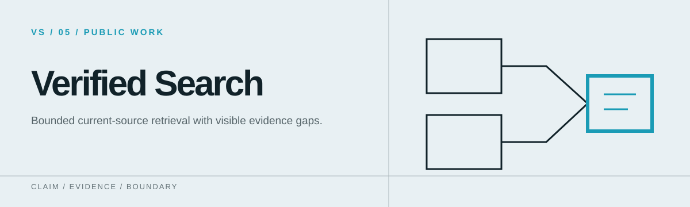
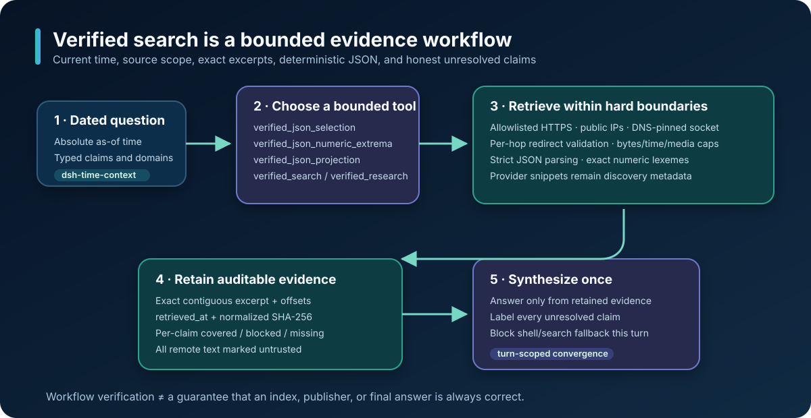
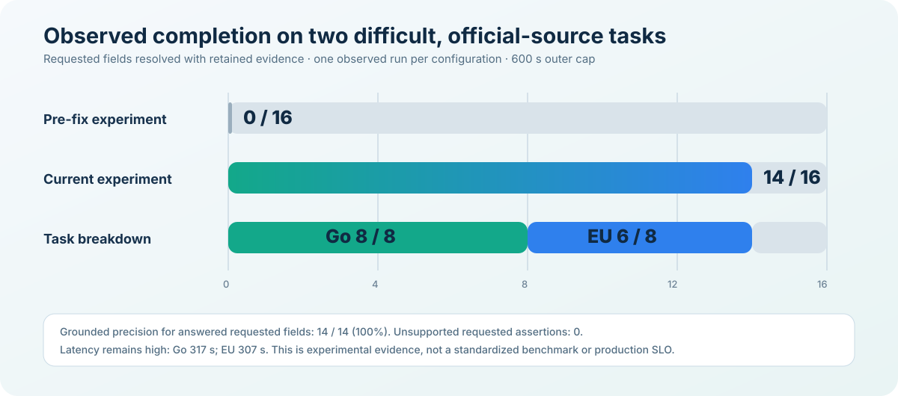

<p align="center">
  
</p>

# dsh-plugin-verified-search

[](https://github.com/f0909172434/dsh-plugin-verified-search/actions/workflows/ci.yml)
[](https://github.com/f0909172434/dsh-plugin-verified-search/releases)
[](LICENSE)

[English](README.md) · [繁體中文](README.zh.md) · [简体中文](README.zh-CN.md)

**A DeepSeek Harness plugin that looks up current sources and shows which evidence it kept and which questions it could not answer.**

The plugin replaces the `web_search` tool an agent inherits with bounded workflows. Each workflow makes visible which sources were in scope, which evidence was kept, how JSON values were selected, and which gaps remain. It is the installable companion to [deepseek-harness Discussion #332](https://github.com/deepseek-ai/deepseek-harness/discussions/332), and it also mounts the time context discussed in [Discussion #344](https://github.com/deepseek-ai/deepseek-harness/discussions/344).

The plugin checks that the workflow and the structured sources meet stated conditions. It does **not** certify that a publisher is telling the truth, and it cannot guarantee that an upstream search index is current.



## Release status

| Track | Install ref | Model-facing tools | Validation boundary |
| --- | --- | --- | --- |
| Stable | `v0.1.1` | `verified_search` | Maintainer-validated release tag with packaged artifacts, checksums, cross-platform CI, clean-profile installation, and recorded live provider conformance |
| Experimental snapshot | `c29b531a6c2e52200d454aa9ded42214ba8c0014` | All five tools listed below | Last green `main` snapshot on 2026-08-16; 250 tests and the 42-case frozen offline corpus passed |
| Moving `main` | `main` | Unreleased development | Do not install unpinned; behavior and generated artifacts may change between commits |

> **No external party has independently validated this plugin.** The evidence in this repository comes from internal deterministic tests, CI, package-reproducibility checks, and conformance runs by the maintainer. None of it is presented as third-party review.

## Prerequisites

- You need DeepSeek Harness `0.1.1-rc.2` and Cordis `4.0.1`. The official `0.1.2-alpha.1` tree was reviewed at the source level and showed no breaking change to any surface this plugin uses. The exact peer contract will move to it once it is published to npm.
- You need Node.js `22.19.x` or `24.x`.
- A `DEEPSEEK_API_KEY` must be available through the Harness credential service or the launch environment.
- You need a preset that can already search. The plugin does not give search capability to the shipped `minimal` preset.
- The plugin can share one `web` profile with the `dsh-web` ecosystem bundle (`@linxin666/dsh-web-all`) and `dsh-deepseek-girl-pet`. The combined five-layer patch was composed with the official `@deepseek-ai/cordis-plugin-include` and produced 169 entries with no duplicate ids, no missing rows and no warnings. No ecosystem package registers `web_search` or mounts `time-context`, and no HTTP routes collide.
- CI covers Ubuntu and Windows. macOS is not currently part of the support contract.

Read [the compatibility contract](docs/COMPATIBILITY.md) before you change the Harness, Cordis, Node, or package-manager version.

## Install in one minute

### Stable `verified_search`

```powershell
dsh plugin --profile web add github:f0909172434/dsh-plugin-verified-search#v0.1.1
dsh --profile web --dump-config
dsh web
```

The same steps as a single PowerShell line:

```powershell
dsh plugin --profile web add github:f0909172434/dsh-plugin-verified-search#v0.1.1; dsh --profile web --dump-config; dsh web
```

The release commits prebuilt `lib/` output and has no install-time build script. A pinned Git install therefore does not run this repository's development toolchain on your machine.

### Experimental five-tool snapshot

```powershell
dsh plugin --profile web add github:f0909172434/dsh-plugin-verified-search#c29b531a6c2e52200d454aa9ded42214ba8c0014
dsh --profile web --dump-config
dsh web
```

Use this snapshot only for development and evaluation. In a reproducible test, do not replace the commit with the moving `main` branch.

If your deployment already mounts the `time-context` row from Discussion #344, set `DSH_VERIFIED_SEARCH_DISABLE_TIME_CONTEXT=1` before starting Harness so that two clock injectors do not run.

### Roll back

```powershell
dsh plugin --profile web remove dsh-plugin-verified-search
dsh web
```

## Minimal quickstart

Ask a search-capable agent a narrow question with an absolute date, for example:

> Find DeepSeek's current flagship API model as of 2026-08-14. Use only `api-docs.deepseek.com`. If the retained sources do not contain an answer-bearing excerpt, report the claim as unresolved instead of filling it from memory.

The matching model-facing `verified_search` arguments are:

```json
{
  "query": "DeepSeek current flagship API model as of 2026-08-14",
  "allowed_domains": ["api-docs.deepseek.com"]
}
```

You should see the following behavior:

- The native provider allowlist is sent upstream.
- The structured sources that come back are filtered again locally, by exact hostname or subdomain.
- URLs that carry credentials, and URL parts that are sensitive or used for tracking, are rejected or removed before results become visible in the session.
- A title or URL without a retained citation excerpt is not promoted to verified evidence.
- An evidence gap stays visible and is not filled with an older or memorized answer.

If you also need independent sources for comparison, run a separate query without a domain restriction. The allowlist is a condition on the hostnames of the structured sources that come back. It is not a network-egress or privacy boundary.

## Choose the right tool

| Tool | Use it for | Bounded result |
| --- | --- | --- |
| `verified_search` | One narrow mutable-fact lookup | Structured-source hostname postfilter and visible citation-excerpt gaps |
| `verified_research` | Multi-entity or multi-claim research | Per-claim retained excerpt, retrieval metadata, content hash, and explicit unresolved claims |
| `verified_json_selection` | Latest/as-of selection from an official JSON feed | Strict RFC 6901 traversal, date cutoff, maximum date, and all final ties |
| `verified_json_numeric_extrema` | Exact numeric maximum or minimum from JSON | Source-lexeme comparison without IEEE-754 loss and all final ties |
| `verified_json_projection` | Every strict matching JSON row in source order | Bounded parent/nested projection with auditable pointer repairs and no inferred ordering |

Only `verified_search` is part of the stable `v0.1.1` release. The other four tools are experimental and exist only in the pinned `0.3.0-experiment.0` snapshot.

### Composite research example

```json
{
  "query": "Identify current flagship API model IDs as of 2026-08-14",
  "lanes": [
    {
      "id": "deepseek",
      "query": "DeepSeek current flagship API model ID as of 2026-08-14",
      "required_claims": [
        {
          "id": "model_id",
          "query": "latest DeepSeek flagship API model identifier",
          "evidence_must_include": ["Model ID"],
          "value_kind": "generic_text",
          "scope": {"kind": "document", "must_include": ["DeepSeek"]}
        }
      ],
      "allowed_domains": ["api-docs.deepseek.com"],
      "seed_urls": ["https://api-docs.deepseek.com/api/list-models/"],
      "gap_query": "site:api-docs.deepseek.com/api/list-models model IDs 2026-08-14"
    }
  ]
}
```

`evidence_must_include` checks that a normalized substring appears in the evidence. It does not judge whether the evidence semantically supports the claim. Do not put the answer you are looking for into a required phrase just to confirm the model's guess.

## Failure behavior

When the plugin cannot meet its conditions, it fails visibly or leaves the claim explicitly unresolved.

- Invalid hostname allowlists, URLs that carry credentials, unsafe redirects, addresses that resolve to non-public networks, unsupported media, malformed charset declarations, invalid UTF-8, and resource-limit violations all produce a visible failure.
- The structured JSON operations reject invalid JSON, duplicate keys, excessive nesting, invalid pointers, missing fields, unsupported numeric projection, row, tie or output limits that are exceeded, and runtimes where the exact number lexeme is unavailable.
- Discovery may skip paths that are known to be binary. A binary seed that you supply explicitly and that is not supported fails visibly instead of being quietly reinterpreted.
- A provider or fetch timeout stops the bounded work and keeps the evidence gap.
- `allClaimsCovered`, `complete: true`, and `truncated: false` describe only the declared bounded operation. They do not prove that a source is fresh, that it supports the claim, that the publisher is authentic, that a feed is complete, or that pagination is exhausted.

## Trust and security boundary

The plugin can enforce that the structured sources it returns, after local filtering, match an explicit hostname allowlist. The experimental full-page reader goes further. It retrieves only bounded public HTTPS targets and applies DNS and IP validation, pinned transport, redirect checks, a check for supported text and JSON media types, charset validation, and byte and time limits.

It does **not** prove that:

- the provider's private candidate pool or generated prose used only allowed domains;
- the provider did not retrieve another page or follow a redirect outside the allowlist;
- the upstream index contains the newest page or ranks time correctly;
- a retained phrase entails the requested claim or handles negation correctly;
- a caller-selected seed URL is canonical, first-party, or authoritative;
- an API response is authentic, complete, unpaginated, correctly ordered, or factually correct;
- text from a public page is safe to follow as instructions.

Search queries are stored durably as Harness session data. Never put secrets, signed URLs, or private data in a query. [SECURITY.md](SECURITY.md) explains private reporting and the full threat boundary.

## Verification snapshot

The pinned experimental snapshot records the following:

- The source commit is `c29b531a6c2e52200d454aa9ded42214ba8c0014`.
- Push CI passed on Ubuntu and Windows across Node `22.19.x` and `24.x`.
- The HonestCI baseline is **250 tests**, with 0 failures, 0 errors and 0 skipped.
- The frozen offline corpus passed **42/42 cases**.
- The registered offline result digest is `sha256:3002001da02d0b8501bcc97ee867109f1bfbf0e1a227d87845db81da658ea5c0`.
- The committed `lib/` output and the package contents passed reproducibility checks.
- No external party has independently validated the snapshot.

Machine-readable facts about lifecycle, runtime, capabilities and architecture live in [`capabilities.json`](capabilities.json) and [`architecture.json`](architecture.json). The evaluation method is described in [docs/OFFLINE_EVALUATION.md](docs/OFFLINE_EVALUATION.md), [docs/PROPERTY_TESTING.md](docs/PROPERTY_TESTING.md), and [docs/HONEST_CI_DOGFOOD.md](docs/HONEST_CI_DOGFOOD.md).

## Observed evaluation



Two live tasks with frozen answer ledgers were each run once, under a 600-second outer time limit:

| Task | Before the fixes | Experimental workflow | Terminal time |
| --- | ---: | ---: | ---: |
| Go supported releases, security scope, and Linux artifact provenance | 0/8 | **8/8** | 317 s |
| EU AI Act amended timeline and GPAI transition dates | 0/8 | **6/8** | 307 s |
| **Combined** | **0/16** | **14/16 (87.5%)** | — |

Every one of the 14 answered fields had retained evidence from an official source, and the other two stayed unresolved. These are single observed runs. They are not a standardized benchmark, a statistical estimate, a latency target or a release guarantee. Both successful runs took longer than 240 seconds, so timeout and latency work is still important.

## Configuration

The bundle can read `DEEPSEEK_API_KEY` from the Harness credential service or the launch environment. These optional configuration fields are available:

| Area | Fields |
| --- | --- |
| Provider | `apiKeyEnv`, `apiKey`, `baseURL`, `model`, `apiVersion` |
| Search limits | `maxTokens`, `maxUses`, `maxResults`, `searchTimeoutMs` |
| Experimental research | `researchTimeoutMs`, `researchMaxResults` |

`researchMaxResults` defaults to 24, must be between 4 and 32, and must be at least the number of claims declared in the call. Treat a configuration change as a change to compatibility and resource limits, not just tuning.

## Development and full verification

```powershell
pnpm install --frozen-lockfile --ignore-scripts
pnpm run check
pnpm test
pnpm run build
pnpm run evaluate:offline
npm pack --dry-run --ignore-scripts --json
git diff --check
git diff --exit-code -- lib
```

A second build must not produce a new `lib/` diff. If the frozen offline digest changes, the behavior has probably changed. Do not update the expected digest just to make CI green.

## Documentation

- [Architecture and ownership boundaries](docs/ARCHITECTURE.md)
- [Compatibility contract](docs/COMPATIBILITY.md)
- [Frozen offline evaluation](docs/OFFLINE_EVALUATION.md)
- [Property-testing contract](docs/PROPERTY_TESTING.md)
- [HonestCI dogfooding evidence](docs/HONEST_CI_DOGFOOD.md)
- [Serial single-maintainer roadmap](docs/ROADMAP.md)
- [Maintenance rules](MAINTENANCE.md)
- [Security policy](SECURITY.md)
- [Change history](CHANGELOG.md)

## Relationship to the upstream core fix

This repository is a compatibility layer that you can deploy today. The provider-neutral change to the Harness core is still [`ce4d0455c`](https://github.com/f0909172434/deepseek-harness/commit/ce4d0455c637e5ba91fbb7b3a88725e7ec097371). If the official project ships equivalent bounded capabilities, this plugin can become an additional verification mode or be retired with a documented migration path.

## Security reporting

To report a suspected credential leak, allowlist bypass, or unsafe page-fetch path, use this repository's private GitHub security-advisory form. Do not paste API keys, signed URLs, private queries, private excerpts, or raw session logs into a public issue.

## License

This project is released under the MIT License.
