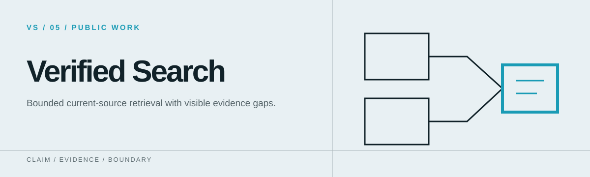
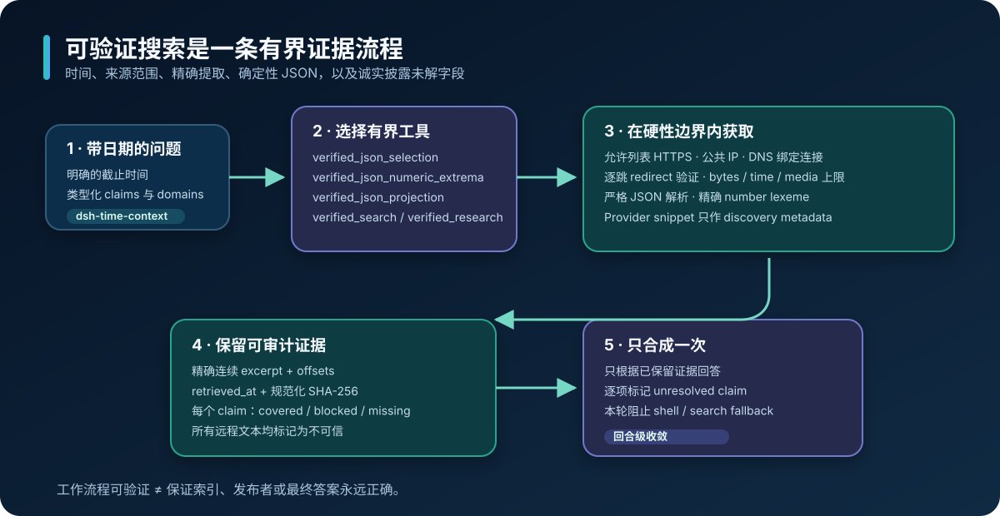
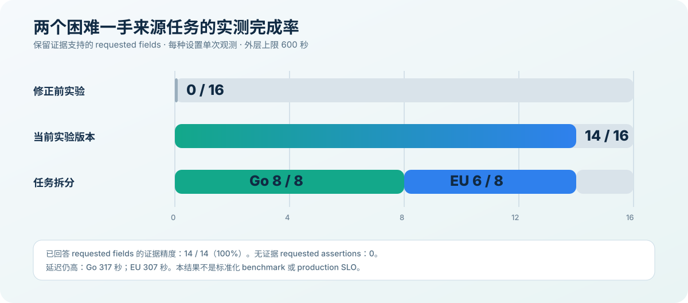

<p align="center">
  
</p>

# dsh-plugin-verified-search

[](https://github.com/f0909172434/dsh-plugin-verified-search/actions/workflows/ci.yml)
[](https://github.com/f0909172434/dsh-plugin-verified-search/releases)
[](LICENSE)

[English](README.md) · [繁體中文](README.zh.md) · [简体中文](README.zh-CN.md)

**DeepSeek Harness 的插件，用来查询最新来源，并清楚列出它保留了哪些证据、哪些问题还没有答案。**

本插件会替换 agent 原本继承的 `web_search`，改用有界的工作流。每个流程都会让人看见：哪些来源在范围内、保留了哪些证据、JSON 值是怎么选出来的，以及还有哪些缺口。它是 [deepseek-harness Discussion #332](https://github.com/deepseek-ai/deepseek-harness/discussions/332) 的可安装配套，也会挂载 [Discussion #344](https://github.com/deepseek-ai/deepseek-harness/discussions/344) 讨论的时间上下文。

它检查的是工作流与 structured sources 是否符合事先声明的条件。它**不会**认证 publisher 的内容一定正确，也无法保证上游搜索索引永远是最新的。



## 发布状态

| 产品线 | 安装 ref | Model-facing 工具 | 验证边界 |
| --- | --- | --- | --- |
| 稳定版 | `v0.1.1` | `verified_search` | 维护者验证的 release tag，包含软件包 artifact、checksums、跨平台 CI、干净 profile 安装和已记录的真实 provider conformance |
| 实验快照 | `c29b531a6c2e52200d454aa9ded42214ba8c0014` | 下列全部五个工具 | 2026-08-16 当时最后一个绿色 `main` 快照；250 tests 和 42-case frozen offline corpus 全部通过 |
| 移动中的 `main` | `main` | 未发布开发代码 | 不要在可复现测试中直接安装；不同 commit 之间的行为和 generated artifacts 可能变化 |

> **目前还没有任何外部单位独立验证过本插件。** Repository 里的证据来自内部的 deterministic tests、CI、package reproducibility checks，以及维护者自己运行的 conformance 测试。这些都不会被描述成第三方审查。

## 前置要求

- 需要 DeepSeek Harness `0.1.1-rc.2` 与 Cordis `4.0.1`。官方 `0.1.2-alpha.1` 已经做过源码层级的审查，本插件用到的 API 都没有破坏性变更。等它发布到 npm 之后，exact peer contract 会随之推进。
- 需要 Node.js `22.19.x` 或 `24.x`。
- 必须通过 Harness credential service 或启动环境提供 `DEEPSEEK_API_KEY`。
- 需要使用本身就有搜索能力的 preset。本插件不会替内置的 `minimal` preset 扩充权限。
- 本插件可以和 `dsh-web` 生态全家桶（`@linxin666/dsh-web-all`）及 `dsh-deepseek-girl-pet` 放在同一个 `web` profile。五层 patch 已用官方 `@deepseek-ai/cordis-plugin-include` 叠加验证，得到 169 个 entries，没有重复 id、没有缺漏、也没有警告。生态软件包都没有注册 `web_search` 或挂载 `time-context`，HTTP 路由也没有碰撞。
- CI 覆盖 Ubuntu 与 Windows。macOS 目前不在正式支持范围内。

更换 Harness、Cordis、Node 或 package-manager 的版本之前，请先阅读[兼容性契约](docs/COMPATIBILITY.md)。

## 一分钟安装

### 稳定版 `verified_search`

```powershell
dsh plugin --profile web add github:f0909172434/dsh-plugin-verified-search#v0.1.1
dsh --profile web --dump-config
dsh web
```

同样的步骤写成一行 PowerShell 命令：

```powershell
dsh plugin --profile web add github:f0909172434/dsh-plugin-verified-search#v0.1.1; dsh --profile web --dump-config; dsh web
```

Release 已经提交预先构建好的 `lib/`，也没有 install-time build script。因此用固定的 Git ref 安装时，不会在你的电脑上运行此 repository 的开发工具链。

### 五工具实验快照

```powershell
dsh plugin --profile web add github:f0909172434/dsh-plugin-verified-search#c29b531a6c2e52200d454aa9ded42214ba8c0014
dsh --profile web --dump-config
dsh web
```

这个快照只适合开发与评估。需要可复现的结果时，不要把明确的 commit 换成会移动的 `main`。

如果你的部署已经挂载了 Discussion #344 的 `time-context` row，请在启动 Harness 前设置 `DSH_VERIFIED_SEARCH_DISABLE_TIME_CONTEXT=1`，避免同时有两个 clock injector。

### 回滚

```powershell
dsh plugin --profile web remove dsh-plugin-verified-search
dsh web
```

## 最小 quickstart

向具搜索能力的 agent 提出范围明确、带有绝对日期的问题，例如：

> 找出截至 2026-08-14 的 DeepSeek 现行旗舰 API model。只使用 `api-docs.deepseek.com`。如果保留来源没有包含答案的 excerpt，请报告 unresolved，不要用记忆补答案。

对应的 model-facing `verified_search` arguments 如下：

```json
{
  "query": "DeepSeek current flagship API model as of 2026-08-14",
  "allowed_domains": ["api-docs.deepseek.com"]
}
```

你应该会看到以下行为：

- 原生的 provider allowlist 会传给上游。
- 返回的 structured sources 会在本地依精确的 hostname 或 subdomain 再过滤一次。
- 带有凭证的 URL，以及敏感或用来追踪的 URL 片段，会在结果出现在 session 之前被拒绝或移除。
- 只有标题或 URL、却没有保留 citation excerpt 的来源，不会被升格成已验证的证据。
- 证据缺口会一直显示出来，不会被旧答案或模型的记忆填补。

如果还需要独立的来源来比较，请另外做一次不限制 domain 的查询。Allowlist 只是对“返回的 structured source hostname”设下的条件，不是 network-egress 或 privacy boundary。

## 选择正确工具

| 工具 | 适合的任务 | 有界结果 |
| --- | --- | --- |
| `verified_search` | 单一、狭窄、会变化的事实查询 | Structured-source hostname postfilter，citation excerpt 缺口保持可见 |
| `verified_research` | 多实体或多 claim 研究 | 每个 claim 的保留 excerpt、retrieval metadata、content hash 和明确 unresolved claims |
| `verified_json_selection` | 从官方 JSON feed 做 latest／as-of 选择 | 严格 RFC 6901、日期 cutoff、最大日期和全部 final ties |
| `verified_json_numeric_extrema` | JSON 的精确数值最大／最小值 | 直接比较 source lexeme、不经过 IEEE-754，并保留全部 final ties |
| `verified_json_projection` | 按来源顺序取得全部严格匹配 JSON rows | 有界 parent／nested projection、可审计 pointer repair、不推测排序语义 |

只有 `verified_search` 属于稳定的 `v0.1.1`。其余四个工具都是实验功能，只存在于固定的 `0.3.0-experiment.0` 快照中。

### 复合研究示例

```json
{
  "query": "Identify current flagship API model IDs as of 2026-08-14",
  "lanes": [
    {
      "id": "deepseek",
      "query": "DeepSeek current flagship API model ID as of 2026-08-14",
      "required_claims": [
        {
          "id": "model_id",
          "query": "latest DeepSeek flagship API model identifier",
          "evidence_must_include": ["Model ID"],
          "value_kind": "generic_text",
          "scope": {"kind": "document", "must_include": ["DeepSeek"]}
        }
      ],
      "allowed_domains": ["api-docs.deepseek.com"],
      "seed_urls": ["https://api-docs.deepseek.com/api/list-models/"],
      "gap_query": "site:api-docs.deepseek.com/api/list-models model IDs 2026-08-14"
    }
  ]
}
```

`evidence_must_include` 只检查规范化后的字符串是否出现在证据里，并不判断证据在语义上是否支持 claim。不要只为了确认模型自己的猜测，就把未知的答案写进 required phrase。

## 失败行为

当插件无法满足条件时，它会明确失败，或把 claim 明确标成 unresolved。

- 无效的 hostname allowlist、带有凭证的 URL、不安全的 redirect、解析到非公开网络的地址、不支持的 media、错误的 charset 声明、无效的 UTF-8，以及超过资源上限的情况，都会产生看得见的失败。
- Structured JSON 操作会拒绝无效 JSON、重复的 key、过深的 nesting、无效的 pointer、缺少的字段、不支持的 numeric projection、超过 row／tie／output 上限的结果，以及无法取得精确 number lexeme 的 runtime。
- Discovery 可以跳过已知的 binary path。明确提供却不支持的 binary seed 会留下看得见的失败，不会被悄悄换成别的解读。
- Provider 或 fetch 超时时，会中止有界的工作，并保留证据缺口。
- `allClaimsCovered`、`complete: true` 或 `truncated: false` 只描述声明过的有界操作。它们不能证明来源是新的、证据支持 claim、publisher 是真的、feed 是完整的，或分页已经全部取完。

## 信任与安全边界

本插件可以保证，经过本地过滤后返回的 structured sources 都符合明确的 hostname allowlist。实验版的完整页面 reader 还会再加限制：只抓取有界的 public HTTPS target，并执行 DNS/IP 验证、pinned transport、redirect 检查、text/JSON media 与 charset 验证，以及 byte/time 上限。

它**不能证明**：

- provider 的私有 candidate pool 或生成的 prose 只用了 allowlist 内的 domain；
- provider 没有自行抓取其他页面，或跟着 redirect 跑到 allowlist 之外；
- 上游索引一定含有最新页面，或时间排序正确；
- 保留的 phrase 在语义上支持 claim，或能正确处理否定；
- caller 指定的 seed URL 一定是 canonical、first-party 或 authoritative；
- API response 是真实、完整、没有分页、排序正确或事实正确的；
- public page 上的文本可以安全地当成指令执行。

Search query 会被长期保存在 Harness session data 中。不要把 secret、signed URL 或私人数据放进 query。私密回报方式与完整的 threat boundary 请看 [SECURITY.md](SECURITY.md)。

## 验证快照

固定的实验快照记录了以下事实：

- Source commit 是 `c29b531a6c2e52200d454aa9ded42214ba8c0014`。
- Push CI 在 Ubuntu 与 Windows、Node `22.19.x` 与 `24.x` 上全部通过。
- HonestCI baseline 是 **250 tests**，0 failures、0 errors、0 skipped。
- Frozen offline corpus 通过 **42/42 cases**。
- 登记的 offline result digest 是 `sha256:3002001da02d0b8501bcc97ee867109f1bfbf0e1a227d87845db81da658ea5c0`。
- 已提交的 `lib/` 与 package 内容通过 reproducibility checks。
- 目前还没有任何外部单位独立验证过这个快照。

Lifecycle、runtime、capability 与 architecture 的 machine-readable 事实放在 [`capabilities.json`](capabilities.json) 和 [`architecture.json`](architecture.json)。评估方法请看 [docs/OFFLINE_EVALUATION.md](docs/OFFLINE_EVALUATION.md)、[docs/PROPERTY_TESTING.md](docs/PROPERTY_TESTING.md) 与 [docs/HONEST_CI_DOGFOOD.md](docs/HONEST_CI_DOGFOOD.md)。

## 实测观察



两个附有冻结答案账本的 live tasks 各跑了一次，外层时间上限是 600 秒：

| 任务 | 修正前 | 实验工作流 | Terminal 时间 |
| --- | ---: | ---: | ---: |
| Go 支持 releases、security scope 和 Linux artifact provenance | 0/8 | **8/8** | 317 秒 |
| EU AI Act 修法时间线和 GPAI 过渡期限 | 0/8 | **6/8** | 307 秒 |
| **合计** | **0/16** | **14/16（87.5%）** | — |

已回答的 14 个字段都有保留下来的官方来源证据，另外两栏维持 unresolved。这些只是单次观测，不是标准化 benchmark、统计估计、latency 目标或 release 保证。两次成功的运行都超过 240 秒，所以 timeout 与 latency 仍是重要的改进方向。

## 配置

Bundle 可以从 Harness credential service 或启动环境读取 `DEEPSEEK_API_KEY`。可选的设置字段如下：

| 类别 | Fields |
| --- | --- |
| Provider | `apiKeyEnv`、`apiKey`、`baseURL`、`model`、`apiVersion` |
| Search limits | `maxTokens`、`maxUses`、`maxResults`、`searchTimeoutMs` |
| Experimental research | `researchTimeoutMs`、`researchMaxResults` |

`researchMaxResults` 默认为 24，范围是 4 到 32，而且不能低于该次调用声明的 claim 数量。改设置等于改动兼容性与资源上限，不只是调整性能。

## 开发和完整验证

```powershell
pnpm install --frozen-lockfile --ignore-scripts
pnpm run check
pnpm test
pnpm run build
pnpm run evaluate:offline
npm pack --dry-run --ignore-scripts --json
git diff --check
git diff --exit-code -- lib
```

第二次 build 不能产生新的 `lib/` diff。Frozen offline digest 一旦改变，代表行为很可能已经改了。不要只为了让 CI 变绿就更新预期的 digest。

## 文档

- [架构与 ownership boundaries](docs/ARCHITECTURE.md)
- [兼容性契约](docs/COMPATIBILITY.md)
- [Frozen offline evaluation](docs/OFFLINE_EVALUATION.md)
- [Property-testing contract](docs/PROPERTY_TESTING.md)
- [HonestCI dogfooding evidence](docs/HONEST_CI_DOGFOOD.md)
- [单人串行维护 roadmap](docs/ROADMAP.md)
- [维护规则](MAINTENANCE.md)
- [安全政策](SECURITY.md)
- [变更记录](CHANGELOG.md)

## 与上游核心修复的关系

此 repository 是现在就能部署的兼容层。Provider-neutral 的 Harness 核心修改仍然是 [`ce4d0455c`](https://github.com/f0909172434/deepseek-harness/commit/ce4d0455c637e5ba91fbb7b3a88725e7ec097371)。如果官方项目推出等价的有界功能，本插件可以转为额外的验证模式，或依照有文档的迁移路径退役。

## 安全报告

如果怀疑有 credential 外泄、allowlist 被绕过，或 page-fetch 路径不安全，请使用此 repository 的 GitHub 私密 security advisory 表单回报。不要把 API key、signed URL、私人 query、私人 excerpt 或原始 session log 贴到公开 issue。

## License

本项目以 MIT License 授权。
