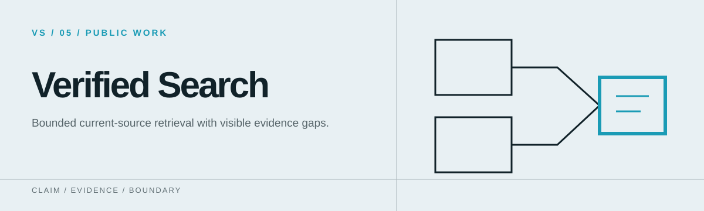
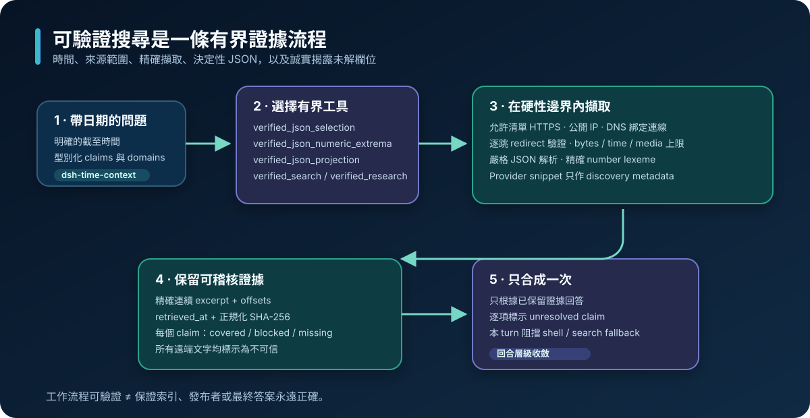
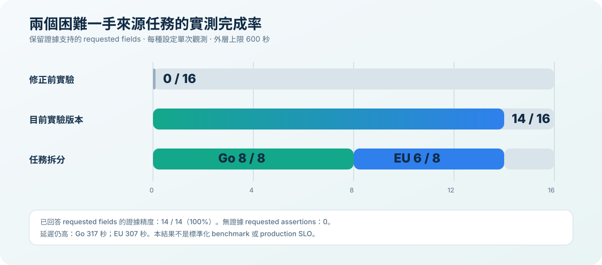

<p align="center">
  
</p>

# dsh-plugin-verified-search

[](https://github.com/f0909172434/dsh-plugin-verified-search/actions/workflows/ci.yml)
[](https://github.com/f0909172434/dsh-plugin-verified-search/releases)
[](LICENSE)

[English](README.md) · [繁體中文](README.zh.md) · [简体中文](README.zh-CN.md)

**DeepSeek Harness 的外掛，用來查詢最新來源，並清楚列出它保留了哪些證據、哪些問題還沒有答案。**

此外掛會替換 agent 原本繼承的 `web_search`，改用有界的工作流程。每個流程都會讓人看見：哪些來源在範圍內、保留了哪些證據、JSON 值是怎麼選出來的，以及還有哪些缺口。它是 [deepseek-harness Discussion #332](https://github.com/deepseek-ai/deepseek-harness/discussions/332) 的可安裝配套，也會掛載 [Discussion #344](https://github.com/deepseek-ai/deepseek-harness/discussions/344) 討論的時間上下文。

它檢查的是工作流程與 structured sources 是否符合事先宣告的條件。它**不會**認證 publisher 的內容一定正確，也無法保證上游搜尋索引永遠是最新的。



## 發布狀態

| 產品線 | 安裝 ref | Model-facing 工具 | 驗證邊界 |
| --- | --- | --- | --- |
| 穩定版 | `v0.1.1` | `verified_search` | 維護者驗證的 release tag，包含套件 artifact、checksums、跨平台 CI、乾淨 profile 安裝與已記錄的真實 provider conformance |
| 實驗快照 | `c29b531a6c2e52200d454aa9ded42214ba8c0014` | 下列全部五個工具 | 2026-08-16 當時最後一個綠燈 `main` 快照；250 tests 與 42-case frozen offline corpus 全通過 |
| 移動中的 `main` | `main` | 未發布開發碼 | 不要在可重現測試中直接安裝；不同 commit 之間的行為與 generated artifacts 可能改變 |

> **目前還沒有任何外部單位獨立驗證過此外掛。** Repository 裡的證據來自內部的 deterministic tests、CI、package reproducibility checks，以及維護者自己執行的 conformance 測試。這些都不會被描述成第三方審查。

## 前置需求

- 需要 DeepSeek Harness `0.1.1-rc.2` 與 Cordis `4.0.1`。官方 `0.1.2-alpha.1` 已經做過源碼層級的審查，此外掛用到的 API 都沒有破壞性變更。等它發布到 npm 之後，exact peer contract 會隨之推進。
- 需要 Node.js `22.19.x` 或 `24.x`。
- 必須透過 Harness credential service 或啟動環境提供 `DEEPSEEK_API_KEY`。
- 需要使用本身就有搜尋能力的 preset。此外掛不會替內建的 `minimal` preset 擴充權限。
- 此外掛可以和 `dsh-web` 生態全家桶（`@linxin666/dsh-web-all`）及 `dsh-deepseek-girl-pet` 放在同一個 `web` profile。五層 patch 已用官方 `@deepseek-ai/cordis-plugin-include` 疊加驗證，得到 169 個 entries，沒有重複 id、沒有缺漏、也沒有警告。生態套件都沒有註冊 `web_search` 或掛載 `time-context`，HTTP 路由也沒有碰撞。
- CI 涵蓋 Ubuntu 與 Windows。macOS 目前不在正式支援範圍內。

更換 Harness、Cordis、Node 或 package-manager 的版本之前，請先閱讀[相容性契約](docs/COMPATIBILITY.md)。

## 一分鐘安裝

### 穩定版 `verified_search`

```powershell
dsh plugin --profile web add github:f0909172434/dsh-plugin-verified-search#v0.1.1
dsh --profile web --dump-config
dsh web
```

同樣的步驟寫成一行 PowerShell 指令：

```powershell
dsh plugin --profile web add github:f0909172434/dsh-plugin-verified-search#v0.1.1; dsh --profile web --dump-config; dsh web
```

Release 已經提交預先建置好的 `lib/`，也沒有 install-time build script。因此用固定的 Git ref 安裝時，不會在你的電腦上執行此 repository 的開發工具鏈。

### 五工具實驗快照

```powershell
dsh plugin --profile web add github:f0909172434/dsh-plugin-verified-search#c29b531a6c2e52200d454aa9ded42214ba8c0014
dsh --profile web --dump-config
dsh web
```

這個快照只適合開發與評估。需要可重現的結果時，不要把明確的 commit 換成會移動的 `main`。

如果你的部署已經掛載了 Discussion #344 的 `time-context` row，請在啟動 Harness 前設定 `DSH_VERIFIED_SEARCH_DISABLE_TIME_CONTEXT=1`，避免同時有兩個 clock injector。

### 回滾

```powershell
dsh plugin --profile web remove dsh-plugin-verified-search
dsh web
```

## 最小 quickstart

向具搜尋能力的 agent 提出範圍明確、帶有絕對日期的問題，例如：

> 找出截至 2026-08-14 的 DeepSeek 現行旗艦 API model。只使用 `api-docs.deepseek.com`。若保留來源沒有包含答案的 excerpt，請回報 unresolved，不要用記憶補答案。

對應的 model-facing `verified_search` arguments 如下：

```json
{
  "query": "DeepSeek current flagship API model as of 2026-08-14",
  "allowed_domains": ["api-docs.deepseek.com"]
}
```

你應該會看到以下行為：

- 原生的 provider allowlist 會傳給上游。
- 回傳的 structured sources 會在本機依精確的 hostname 或 subdomain 再過濾一次。
- 帶有憑證的 URL，以及敏感或用來追蹤的 URL 片段，會在結果出現在 session 之前被拒絕或移除。
- 只有標題或 URL、卻沒有保留 citation excerpt 的來源，不會被升格成已驗證的證據。
- 證據缺口會一直顯示出來，不會被舊答案或模型的記憶填補。

如果還需要獨立的來源來比較，請另外做一次不限制 domain 的查詢。Allowlist 只是對「回傳的 structured source hostname」設下的條件，不是 network-egress 或 privacy boundary。

## 選擇正確工具

| 工具 | 適合的任務 | 有界結果 |
| --- | --- | --- |
| `verified_search` | 單一、狹窄、會變動的事實查詢 | Structured-source hostname postfilter，citation excerpt 缺口保持可見 |
| `verified_research` | 多實體或多 claim 研究 | 每個 claim 的保留 excerpt、retrieval metadata、content hash 與明確 unresolved claims |
| `verified_json_selection` | 從官方 JSON feed 做 latest／as-of 選取 | 嚴格 RFC 6901、日期 cutoff、最大日期與全部 final ties |
| `verified_json_numeric_extrema` | JSON 的精確數值最大／最小值 | 直接比較 source lexeme、不經 IEEE-754，並保留全部 final ties |
| `verified_json_projection` | 依來源順序取得全部嚴格相符 JSON rows | 有界 parent／nested projection、可稽核 pointer repair、不推測排序語意 |

只有 `verified_search` 屬於穩定的 `v0.1.1`。其餘四個工具都是實驗功能，只存在於固定的 `0.3.0-experiment.0` 快照中。

### 複合研究範例

```json
{
  "query": "Identify current flagship API model IDs as of 2026-08-14",
  "lanes": [
    {
      "id": "deepseek",
      "query": "DeepSeek current flagship API model ID as of 2026-08-14",
      "required_claims": [
        {
          "id": "model_id",
          "query": "latest DeepSeek flagship API model identifier",
          "evidence_must_include": ["Model ID"],
          "value_kind": "generic_text",
          "scope": {"kind": "document", "must_include": ["DeepSeek"]}
        }
      ],
      "allowed_domains": ["api-docs.deepseek.com"],
      "seed_urls": ["https://api-docs.deepseek.com/api/list-models/"],
      "gap_query": "site:api-docs.deepseek.com/api/list-models model IDs 2026-08-14"
    }
  ]
}
```

`evidence_must_include` 只檢查正規化後的字串是否出現在證據裡，並不判斷證據在語意上是否支持 claim。不要只為了確認模型自己的猜測，就把未知的答案寫進 required phrase。

## 失敗行為

當外掛無法滿足條件時，它會明確失敗，或把 claim 明確標成 unresolved。

- 無效的 hostname allowlist、帶有憑證的 URL、不安全的 redirect、解析到非公開網路的位址、不支援的 media、錯誤的 charset 宣告、無效的 UTF-8，以及超過資源上限的情況，都會產生看得見的失敗。
- Structured JSON 操作會拒絕無效 JSON、重複的 key、過深的 nesting、無效的 pointer、缺少的欄位、不支援的 numeric projection、超過 row／tie／output 上限的結果，以及無法取得精確 number lexeme 的 runtime。
- Discovery 可以略過已知的 binary path。明確提供卻不支援的 binary seed 會留下看得見的失敗，不會被悄悄換成別的解讀。
- Provider 或 fetch 逾時時，會中止有界的工作，並保留證據缺口。
- `allClaimsCovered`、`complete: true` 或 `truncated: false` 只描述宣告過的有界操作。它們不能證明來源是新的、證據支持 claim、publisher 是真的、feed 是完整的，或分頁已經全部取完。

## 信任與安全邊界

此外掛可以保證，經過本機過濾後回傳的 structured sources 都符合明確的 hostname allowlist。實驗版的完整頁面 reader 還會再加限制：只擷取有界的 public HTTPS target，並執行 DNS/IP 驗證、pinned transport、redirect 檢查、text/JSON media 與 charset 驗證，以及 byte/time 上限。

它**不能證明**：

- provider 的私有 candidate pool 或生成的 prose 只用了 allowlist 內的 domain；
- provider 沒有自行擷取其他頁面，或跟著 redirect 跑到 allowlist 之外；
- 上游索引一定含有最新頁面，或時間排序正確；
- 保留的 phrase 在語意上支持 claim，或能正確處理否定；
- caller 指定的 seed URL 一定是 canonical、first-party 或 authoritative；
- API response 是真實、完整、沒有分頁、排序正確或事實正確的；
- public page 上的文字可以安全地當成指令執行。

Search query 會被長期保存在 Harness session data 中。不要把 secret、signed URL 或私人資料放進 query。私密回報方式與完整的 threat boundary 請看 [SECURITY.md](SECURITY.md)。

## 驗證快照

固定的實驗快照記錄了以下事實：

- Source commit 是 `c29b531a6c2e52200d454aa9ded42214ba8c0014`。
- Push CI 在 Ubuntu 與 Windows、Node `22.19.x` 與 `24.x` 上全部通過。
- HonestCI baseline 是 **250 tests**，0 failures、0 errors、0 skipped。
- Frozen offline corpus 通過 **42/42 cases**。
- 登記的 offline result digest 是 `sha256:3002001da02d0b8501bcc97ee867109f1bfbf0e1a227d87845db81da658ea5c0`。
- 已提交的 `lib/` 與 package 內容通過 reproducibility checks。
- 目前還沒有任何外部單位獨立驗證過這個快照。

Lifecycle、runtime、capability 與 architecture 的 machine-readable 事實放在 [`capabilities.json`](capabilities.json) 和 [`architecture.json`](architecture.json)。評估方法請看 [docs/OFFLINE_EVALUATION.md](docs/OFFLINE_EVALUATION.md)、[docs/PROPERTY_TESTING.md](docs/PROPERTY_TESTING.md) 與 [docs/HONEST_CI_DOGFOOD.md](docs/HONEST_CI_DOGFOOD.md)。

## 實測觀測



兩個附有凍結答案帳本的 live tasks 各跑了一次，外層時間上限是 600 秒：

| 任務 | 修正前 | 實驗工作流程 | Terminal 時間 |
| --- | ---: | ---: | ---: |
| Go 支援 releases、security scope 與 Linux artifact provenance | 0/8 | **8/8** | 317 秒 |
| EU AI Act 修法時序與 GPAI 過渡期限 | 0/8 | **6/8** | 307 秒 |
| **合計** | **0/16** | **14/16（87.5%）** | — |

已回答的 14 個欄位都有保留下來的官方來源證據，另外兩欄維持 unresolved。這些只是單次觀測，不是標準化 benchmark、統計估計、latency 目標或 release 保證。兩次成功的執行都超過 240 秒，所以 timeout 與 latency 仍是重要的改進方向。

## 設定

Bundle 可以從 Harness credential service 或啟動環境讀取 `DEEPSEEK_API_KEY`。可選的設定欄位如下：

| 類別 | Fields |
| --- | --- |
| Provider | `apiKeyEnv`、`apiKey`、`baseURL`、`model`、`apiVersion` |
| Search limits | `maxTokens`、`maxUses`、`maxResults`、`searchTimeoutMs` |
| Experimental research | `researchTimeoutMs`、`researchMaxResults` |

`researchMaxResults` 預設為 24，範圍是 4 到 32，而且不能低於該次呼叫宣告的 claim 數量。改設定等於改動相容性與資源上限，不只是調整效能。

## 開發與完整驗證

```powershell
pnpm install --frozen-lockfile --ignore-scripts
pnpm run check
pnpm test
pnpm run build
pnpm run evaluate:offline
npm pack --dry-run --ignore-scripts --json
git diff --check
git diff --exit-code -- lib
```

第二次 build 不能產生新的 `lib/` diff。Frozen offline digest 一旦改變，代表行為很可能已經改了。不要只為了讓 CI 變綠就更新預期的 digest。

## 文件

- [架構與 ownership boundaries](docs/ARCHITECTURE.md)
- [相容性契約](docs/COMPATIBILITY.md)
- [Frozen offline evaluation](docs/OFFLINE_EVALUATION.md)
- [Property-testing contract](docs/PROPERTY_TESTING.md)
- [HonestCI dogfooding evidence](docs/HONEST_CI_DOGFOOD.md)
- [單人串行維護 roadmap](docs/ROADMAP.md)
- [維護規則](MAINTENANCE.md)
- [安全政策](SECURITY.md)
- [變更紀錄](CHANGELOG.md)

## 與上游核心修復的關係

此 repository 是現在就能部署的相容層。Provider-neutral 的 Harness 核心修改仍然是 [`ce4d0455c`](https://github.com/f0909172434/deepseek-harness/commit/ce4d0455c637e5ba91fbb7b3a88725e7ec097371)。如果官方專案推出等價的有界功能，此外掛可以轉為額外的驗證模式，或依照有文件的遷移路徑退役。

## 安全回報

如果懷疑有 credential 外洩、allowlist 被繞過，或 page-fetch 路徑不安全，請使用此 repository 的 GitHub 私密 security advisory 表單回報。不要把 API key、signed URL、私人 query、私人 excerpt 或原始 session log 貼到公開 issue。

## License

本專案以 MIT License 授權。
